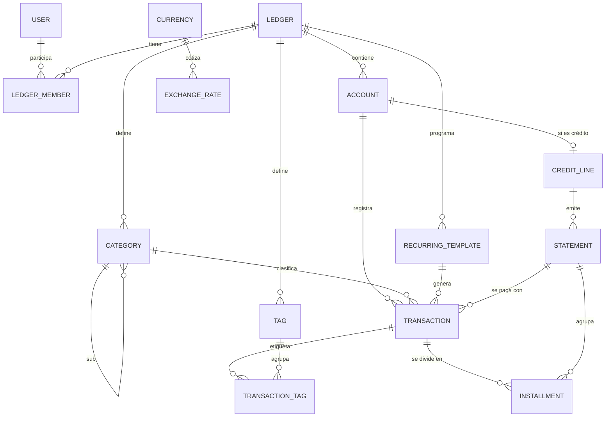

# 01 · Modelo de datos

> **Estado:** v4 · 2026-10-18. Cerrado; la §10 lista los dos datos que faltan.
> **Motor:** SQL Server · **Acceso:** EF Core
> **Origen:** análisis completo de `OrganizadorEconómico 2.xlsx` (14 hojas mensuales, sep-2025 → oct-2026, más la hoja `Cuotas`).

---

## 1. Principios

1. **Transaccional, no mensual.** Cada peso que se mueve es una fila en `Transactions`. El "mes" es un filtro (`WHERE Date …`), no una estructura.
2. **El saldo es una suma.** Los montos llevan signo, así que el saldo de cualquier cuenta es `SUM(Amount)`. No se guarda ningún saldo, total ni acumulado: se calculan.
3. **El medio de pago es una cuenta.** Banco, Efectivo, Mercado Pago, Ahorro, cada tarjeta y Mercado Crédito son `Accounts`. Las de crédito no son líquidas.
4. **Cada monto en su moneda.** Los montos se guardan en su moneda nativa. La conversión a ARS ocurre solo al mostrar, con la cotización histórica del día.
5. **Todo pertenece a un libro.** Los datos cuelgan de un `Ledger` y los usuarios son miembros de ese libro. Queda preparado para multiusuario desde el día uno.

---

## 2. Del Excel a la base

| En el Excel | En la base |
|---|---|
| Una hoja por mes | Filtro por `Date` / `Period` |
| Saldo inicial Banco / Efvo / Ahorro | Un movimiento `opening` por cuenta, una sola vez (sep-2025) |
| Sueldo (implícito en "Banco" = 1.800.000 desde mayo) | Ingreso recurrente (`RecurringTemplates`) |
| Aguinaldo (escrito en la fila de Efvo, junio) | Ingreso recurrente cada 6 meses |
| Saldo total | Suma de las cuentas líquidas |
| Disponible para gastar | Cálculo derivado (§5, R8) |
| Ahorro total (`=SUM(800000, …)`, arrastrado a mano) | Saldo de la cuenta Ahorro |
| Rendimiento diario | Movimientos `yield` |
| Gastos fijos | Movimientos generados por plantillas recurrentes + resúmenes de crédito |
| Gastos variables | Movimientos `expense` |
| Columna "Medio" | `AccountId` |
| Hoja `Cuotas` | `Installments` agrupadas en `Statements` |
| "Gastos a un pago" | Compra a crédito con 1 cuota |
| TOTAL de cada tarjeta / TOTAL PES / TOTAL USD | Suma derivada de las cuotas del resumen, por moneda |
| Cotización `*1500` dentro de la fórmula | `ExchangeRates` (blue, venta) |
| "faltante" | Movimiento `adjustment` |
| Notas sueltas en celdas | `Description` del movimiento / `Note` del resumen |

---

## 3. Diagrama

> Toda columna de moneda (`Currency`, `DefaultCurrency`, `BaseCurrency`) es FK a `Currencies`. Para no saturar el diagrama, esas relaciones no se dibujan.

---

## 4. Tablas

### 4.0 Convenciones comunes

**Columnas de auditoría.** Las llevan todas las tablas excepto `Currencies`, `ExchangeRates` y las tablas de unión:

| Columna | Tipo | Null | Notas |
|---|---|---|---|
| `CreatedAt` | `datetime2(3)` | no | UTC, default `SYSUTCDATETIME()` |
| `UpdatedAt` | `datetime2(3)` | sí | UTC |
| `DeletedAt` | `datetime2(3)` | sí | Borrado lógico. Un filtro global de EF Core lo excluye |
| `RowVersion` | `rowversion` | no | Concurrencia optimista: si el mismo registro se edita desde el celular y desde la PC, el segundo guardado recibe un conflicto en lugar de pisar al primero |

Las tablas de unión (`LedgerMembers`, `TransactionTags`) no tienen `DeletedAt`. Si se borra lógicamente lo que las contiene, sus filas se conservan, así un "deshacer" recupera también las etiquetas.

**Enums.** Se guardan como `varchar(20)` en snake_case (`TransactionKind.CardPayment` → `card_payment`), con un `CHECK` que lista los valores válidos. Se leen bien directo en la base y no se rompen si se reordena el enum.

**Multiusuario.** Toda tabla raíz tiene `LedgerId`. El filtro global de EF Core por el libro del usuario autenticado se agrega junto con el login.

---

### 4.1 `Users`

| Columna | Tipo | Null | Notas |
|---|---|---|---|
| `Id` | `uniqueidentifier` | no | PK |
| `Email` | `nvarchar(256)` | no | UNIQUE |
| `DisplayName` | `nvarchar(100)` | no | |

> Es la tabla de usuarios de ASP.NET Core Identity (`AppUser : IdentityUser<Guid>`), con `DisplayName` como columna extra. Identity agrega sus propias tablas: passkeys, logins y tokens. Ver [02 · Backend §5](02-backend.md#5-seguridad-y-login).

### 4.2 `Ledgers`

| Columna | Tipo | Null | Notas |
|---|---|---|---|
| `Id` | `uniqueidentifier` | no | PK |
| `Name` | `nvarchar(100)` | no | "Mis finanzas" |
| `BaseCurrency` | `char(3)` | no | FK, default `'ARS'` |
| `ReferenceRateSource` | `varchar(20)` | no | Default `'blue'`. Casa usada para convertir totales |
| `TimeZone` | `varchar(64)` | no | Default `'America/Argentina/Buenos_Aires'`. Define qué es "hoy" y "el mes actual": el servidor trabaja en UTC, y sin esto el día 31 a las 21 h ya pensaría que es el mes siguiente |

### 4.3 `LedgerMembers`

| Columna | Tipo | Null | Notas |
|---|---|---|---|
| `LedgerId` | `uniqueidentifier` | no | PK compuesta, FK |
| `UserId` | `uniqueidentifier` | no | PK compuesta. La FK a `Users` se agrega junto con ASP.NET Core Identity |
| `Role` | `varchar(20)` | no | `owner` · `editor` · `viewer` |

### 4.4 `Currencies`

| Columna | Tipo | Null | Notas |
|---|---|---|---|
| `Code` | `char(3)` | no | PK, ISO 4217 |
| `Name` | `nvarchar(50)` | no | |
| `Symbol` | `nvarchar(5)` | no | |

Semilla: `ARS` ($), `USD` (US$).

### 4.5 `ExchangeRates`

Son datos globales: no pertenecen a un libro. Cada fila dice cuántos ARS vale 1 unidad de `Currency`.

| Columna | Tipo | Null | Notas |
|---|---|---|---|
| `Id` | `bigint IDENTITY` | no | PK |
| `Currency` | `char(3)` | no | FK. Moneda cotizada |
| `Source` | `varchar(20)` | no | `oficial` · `blue` · `bolsa` · `contadoconliqui` · `mayorista` · `cripto` · `tarjeta` |
| `RateDate` | `date` | no | |
| `Buy` | `decimal(18,6)` | no | |
| `Sell` | `decimal(18,6)` | no | |
| `FetchedAt` | `datetime2(3)` | no | UTC |

- `UNIQUE (Currency, Source, RateDate)`. Se hace upsert y queda la última cotización del día.
- Fuente actual: DolarApi (`GET https://dolarapi.com/v1/dolares`). Para el histórico: ArgentinaDatos (`GET https://api.argentinadatos.com/v1/cotizaciones/dolares/{casa}`), con backfill desde 2025-09-01.

### 4.6 `Accounts`

| Columna | Tipo | Null | Notas |
|---|---|---|---|
| `Id` | `uniqueidentifier` | no | PK |
| `LedgerId` | `uniqueidentifier` | no | FK |
| `Name` | `nvarchar(60)` | no | |
| `Kind` | `varchar(20)` | no | `bank` · `cash` · `wallet` · `savings` · `credit` |
| `DefaultCurrency` | `char(3)` | no | FK. Moneda que se propone al cargar |
| `IsLiquid` | `bit` | no | Entra en el "saldo total" y el "disponible" |
| `EarnsYield` | `bit` | no | Admite movimientos `yield` |
| `Color` | `char(7)` | sí | Para la UI |
| `Icon` | `varchar(40)` | sí | Para la UI |
| `SortOrder` | `smallint` | no | |
| `ArchivedAt` | `datetime2(3)` | sí | La cuenta se cerró: no se muestra, pero conserva su historia |

- `UNIQUE (LedgerId, Name)` filtrado por `DeletedAt IS NULL`.
- `CHECK (Kind <> 'credit' OR IsLiquid = 0)`.
- `IsLiquid` por defecto según `Kind`: `bank`, `cash` y `wallet` son líquidas; `savings` y `credit`, no.
- Una cuenta puede tener saldo en más de una moneda: una tarjeta, por ejemplo, tiene cargos en ARS y en USD. El saldo se calcula agrupando por `Currency`.

**Semilla a partir del Excel:** Banco (Supervielle), Efectivo, Mercado Pago, Ahorro, Visa (Supervielle), Mastercard (Supervielle), Patagonia, Mercado Crédito y una cuenta en USD (falta confirmar dónde están los dólares; ver §10).

### 4.7 `CreditLines`

Es la extensión 1:1 de una `Account` con `Kind = 'credit'`. Cubre tanto tarjetas como Mercado Crédito, porque en tu Excel funcionan igual: compras en cuotas que se pagan en un vencimiento mensual.

| Columna | Tipo | Null | Notas |
|---|---|---|---|
| `AccountId` | `uniqueidentifier` | no | PK y FK a `Accounts` |
| `LineType` | `varchar(20)` | no | `card` · `installment_credit` |
| `Issuer` | `nvarchar(60)` | no | Supervielle, Patagonia, Mercado Pago |
| `Network` | `varchar(20)` | sí | `visa` · `mastercard`. Null en Mercado Crédito |
| `UsualClosingDay` | `tinyint` | sí | 1–31. Null si la línea no tiene cierre |
| `UsualDueDay` | `tinyint` | no | 1–31 |

> Los días "habituales" solo sirven para proponer las fechas de resúmenes futuros. Las fechas reales viven en cada `Statement`, porque cambian: tu Excel registra un cambio de cierre y vencimiento en ene-2026.

### 4.8 `Statements`

Un resumen por línea de crédito y por mes de vencimiento.

| Columna | Tipo | Null | Notas |
|---|---|---|---|
| `Id` | `uniqueidentifier` | no | PK |
| `CreditAccountId` | `uniqueidentifier` | no | FK a `Accounts`. EF Core no admite FK hacia una tabla owned como `CreditLines`, que de todos modos tiene la misma clave |
| `Period` | `date` | no | Día 1 del **mes de vencimiento**. `CHECK (DAY(Period) = 1)` |
| `ClosingDate` | `date` | sí | Null en líneas sin cierre |
| `DueDate` | `date` | no | |
| `Status` | `varchar(20)` | no | `open` · `paid`. "Cerrado" no se guarda: se deriva comparando la fecha de hoy con `ClosingDate`, así no hace falta un job que lo actualice |
| `IsEstimated` | `bit` | no | 1 = fechas propuestas a partir de los días habituales |
| `Note` | `nvarchar(500)` | sí | |

- `UNIQUE (CreditAccountId, Period)`.
- `CHECK (ClosingDate IS NULL OR ClosingDate < DueDate)`.
- **El total no se guarda:** es `SUM(Installments.Amount)` agrupado por `Currency`, así que un mismo resumen puede tener total en ARS y en USD.

### 4.9 `Categories`

| Columna | Tipo | Null | Notas |
|---|---|---|---|
| `Id` | `uniqueidentifier` | no | PK |
| `LedgerId` | `uniqueidentifier` | no | FK |
| `ParentId` | `uniqueidentifier` | sí | FK a sí misma. Máximo 2 niveles (regla de dominio) |
| `Name` | `nvarchar(60)` | no | |
| `Kind` | `varchar(20)` | no | `expense` · `income` |
| `Color` | `char(7)` | sí | |
| `Icon` | `varchar(40)` | sí | |
| `IsSystem` | `bit` | no | No se puede borrar (Ajuste, Rendimientos) |
| `SortOrder` | `smallint` | no | |

- `UNIQUE (LedgerId, ParentId, Name)` filtrado por `DeletedAt IS NULL`.

**Semilla propuesta (editable).** Las de gasto incluyen tus categorías actuales y otras que surgen de lo que cargás en `Cuotas`:
- **Gasto:** Comida, Helado, Nafta, Cancha, Veterinaria, Supermercado, Regalos, Ropa, Deporte, Viajes, Suscripciones, Belleza, Trámites, Transporte, Impuestos y comisiones, Otro.
- **Ingreso:** Sueldo, Aguinaldo, Rendimientos, Otros ingresos.
- **Sistema:** Ajuste.

### 4.10 `Transactions`

La tabla central del modelo.

| Columna | Tipo | Null | Notas |
|---|---|---|---|
| `Id` | `uniqueidentifier` | no | PK |
| `LedgerId` | `uniqueidentifier` | no | FK. Denormalizado para filtrar e indexar |
| `AccountId` | `uniqueidentifier` | no | FK. **El medio** |
| `Date` | `date` | no | Fecha del consumo o del movimiento |
| `Amount` | `decimal(18,2)` | no | Con signo, `≠ 0` |
| `Currency` | `char(3)` | no | FK |
| `Kind` | `varchar(20)` | no | Ver la tabla de tipos |
| `Status` | `varchar(20)` | no | `planned` · `confirmed` |
| `CategoryId` | `uniqueidentifier` | sí | FK. Requerida en `expense`, `refund` e `income` |
| `Description` | `nvarchar(200)` | sí | |
| `TransferGroupId` | `uniqueidentifier` | sí | Une las dos patas de `transfer` y `card_payment` |
| `RecurringTemplateId` | `uniqueidentifier` | sí | FK. Plantilla que lo generó |
| `RecurringPeriod` | `date` | sí | Día 1 del mes para el que se generó |
| `PaidStatementId` | `uniqueidentifier` | sí | FK a `Statements`. Solo en `card_payment` |

**Tipos de movimiento**

| `Kind` | Signo | Cuenta | Categoría | Uso |
|---|---|---|---|---|
| `expense` | − | cualquiera | de gasto | Si la cuenta es de crédito, genera cuotas |
| `refund` | + | cualquiera | de gasto | Devolución o reintegro: descuenta del gasto de su categoría |
| `income` | + | cualquiera | de ingreso | Sueldo, aguinaldo |
| `yield` | + | `EarnsYield = 1` | opcional | Rendimiento |
| `transfer` | ± | dos patas | — | Mover entre cuentas. Si las monedas difieren, es una compra o venta de dólares |
| `card_payment` | ± | líquida (−) / crédito (+) | — | Pago de un resumen |
| `opening` | ± | cualquiera | — | Saldo inicial: uno por cuenta y moneda |
| `adjustment` | ± | cualquiera | Ajuste | Diferencia entre el saldo real y el calculado |

**Restricciones**
- `CHECK (Amount <> 0)`
- `CHECK ((Kind = 'expense' AND Amount < 0) OR (Kind IN ('refund','income','yield') AND Amount > 0) OR Kind IN ('transfer','card_payment','opening','adjustment'))`
- `CHECK ((Kind IN ('transfer','card_payment')) = (TransferGroupId IS NOT NULL))`, escrito con `CASE`, porque T-SQL no compara booleanos directamente.
- `CHECK ((Kind = 'card_payment') = (PaidStatementId IS NOT NULL))`, ídem.
- `CHECK ((RecurringTemplateId IS NULL) = (RecurringPeriod IS NULL))`, ídem.
- `UNIQUE (RecurringTemplateId, RecurringPeriod, AccountId) WHERE RecurringTemplateId IS NOT NULL`. Incluye la cuenta porque una transferencia recurrente genera dos patas. El filtro **no** excluye borrados a propósito: si borrás un fijo generado, no vuelve a aparecer ese mes.

**Índices**
- `IX (LedgerId, Date) INCLUDE (Amount, Currency, Kind, Status, CategoryId, AccountId)`
- `IX (AccountId, Date)`
- `IX (TransferGroupId) WHERE TransferGroupId IS NOT NULL`
- `IX (PaidStatementId) WHERE PaidStatementId IS NOT NULL`

### 4.11 `Installments`

Cada compra (`expense`) o devolución (`refund`) sobre una cuenta de crédito se divide en una o más cuotas. Una compra en 1 pago tiene 1 cuota.

| Columna | Tipo | Null | Notas |
|---|---|---|---|
| `Id` | `uniqueidentifier` | no | PK |
| `TransactionId` | `uniqueidentifier` | no | FK. La compra |
| `StatementId` | `uniqueidentifier` | no | FK. Resumen en el que cae |
| `Number` | `smallint` | no | Número de cuota |
| `Total` | `smallint` | no | Total de cuotas. `CHECK (1 <= Number AND Number <= Total)` |
| `Amount` | `decimal(18,2)` | no | `≠ 0`. Positivo = cargo; negativo = devolución |
| `Currency` | `char(3)` | no | FK |

- `UNIQUE (TransactionId, Number)` · `IX (StatementId)`.
- **Invariantes de dominio:**
  - `Σ Amount = −Transaction.Amount`.
  - `Currency` es la misma que la de la compra.
  - Todas las cuotas de una compra tienen el mismo `Total` y números consecutivos.
  - El resumen pertenece a la misma cuenta que la compra.
- **Los montos son editables cuota por cuota**, porque en tu Excel no siempre son iguales: "Perfume mamá" 30.000 / 30.000 / **31.600**; "botines papá" 50.000 / **52.000** / 52.000. Al editar una cuota se recalcula el total de la compra para mantener el primer invariante.

### 4.12 `RecurringTemplates`

| Columna | Tipo | Null | Notas |
|---|---|---|---|
| `Id` | `uniqueidentifier` | no | PK |
| `LedgerId` | `uniqueidentifier` | no | FK |
| `Description` | `nvarchar(200)` | no | |
| `Kind` | `varchar(20)` | no | `expense` · `income` · `transfer` |
| `AccountId` | `uniqueidentifier` | no | FK. Cuenta del gasto o ingreso, u origen de la transferencia |
| `ToAccountId` | `uniqueidentifier` | sí | FK. Solo en `transfer` |
| `CategoryId` | `uniqueidentifier` | sí | FK. Requerida en `expense` e `income` |
| `EstimatedAmount` | `decimal(18,2)` | no | `> 0`, en valor absoluto: el signo lo da `Kind` |
| `Currency` | `char(3)` | no | FK |
| `Frequency` | `varchar(20)` | no | `monthly` · `yearly` |
| `Interval` | `tinyint` | no | Default 1. Cada cuántos períodos se repite |
| `DayOfMonth` | `tinyint` | no | 1–31. Si el mes es más corto, se usa el último día |
| `StartsOn` | `date` | no | |
| `EndsOn` | `date` | sí | |
| `IsActive` | `bit` | no | |

- `CHECK ((Kind = 'transfer') = (ToAccountId IS NOT NULL))`.

**Casos de tu Excel**

| Caso | Configuración |
|---|---|
| Sueldo | `income` en Banco, mensual |
| Aguinaldo | `income`, `monthly` con `Interval = 6`, desde 2026-06 |
| Ahorro mensual | `transfer` de Banco a Ahorro |
| YouTube Premium | `expense` en Visa: cae solo en el resumen |
| Claude | `expense` de USD 40 en Patagonia |
| Viaje a Mendoza (6 cuotas fuera de tarjeta) | `expense` con `EndsOn` en la 6ª cuota |

### 4.13 `Tags` y `TransactionTags`

| `Tags` | Tipo | Null | Notas |
|---|---|---|---|
| `Id` | `uniqueidentifier` | no | PK |
| `LedgerId` | `uniqueidentifier` | no | FK |
| `Name` | `nvarchar(40)` | no | `UNIQUE (LedgerId, Name)` |
| `Color` | `char(7)` | sí | |

| `TransactionTags` | Tipo | Null | Notas |
|---|---|---|---|
| `TransactionId` | `uniqueidentifier` | no | PK compuesta, FK |
| `TagId` | `uniqueidentifier` | no | PK compuesta, FK. `IX (TagId)` |

Las etiquetas son una segunda dimensión, independiente de la categoría:
- La **categoría** responde *en qué* gastás.
- La **etiqueta** responde *con quién, para quién o para qué*: Lu, mamá, papá, abuela, Mendoza, Pinamar, Brasil, gym.

---

## 5. Reglas de negocio

| # | Regla |
|---|---|
| **R1** | **Saldo** de una cuenta = `SUM(Amount)` de sus movimientos `confirmed`, agrupado por moneda. El **saldo proyectado** suma además los `planned`. |
| **R2** | **Transferencia** = exactamente 2 patas con el mismo `TransferGroupId` y signos opuestos. Si las monedas difieren, la cotización real es `|ARS| / |USD|` y queda implícita en la operación. |
| **R3** | **Compra a crédito** en N cuotas: se reparte `total / N` y el redondeo va a la última cuota. Los montos son editables (§4.11). |
| **R4** | **Asignación de cuota a resumen.** La cuota 1 va al primer resumen con `ClosingDate ≥ fecha de compra`; en líneas sin cierre, al primer resumen con `DueDate > fecha de compra`. La cuota *k* va *k−1* resúmenes después. Si no existen resúmenes futuros, se crean con `IsEstimated = 1`. |
| **R5** | **Cambio de fechas de un resumen.** Se reasignan las cuotas de las compras que quedaron del otro lado del nuevo cierre. Un resumen con pagos no se reasigna. |
| **R6** | **Pago de resumen** = `card_payment` (líquida −, crédito +). El resumen queda `paid` cuando, en cada moneda, lo pagado cubre el total. Puede tener varios pagos, por ejemplo la parte en USD con dólares propios. |
| **R7** | **Recurrentes.** Un job genera los movimientos `planned` de cada mes; es idempotente gracias al `UNIQUE`. Al confirmarlos se puede corregir el monto o la fecha. Un `planned` vencido sigue contando como compromiso hasta que se confirma o se borra. |
| **R8** | **Disponible(mes)**, por moneda = saldo líquido al inicio del mes + ingresos del mes − egresos confirmados del mes − `planned` pendientes del mes − saldo impago de los resúmenes que vencen en el mes. |
| **R8b** | **Vista unificada en ARS.** Si los compromisos en USD superan el saldo líquido en USD, el faltante se resta del disponible en ARS, convertido al blue. Reemplaza el `*1500` y el `*0` manuales del Excel: si tenés dólares para cubrir Claude, no te resta pesos. |
| **R9** | **Cotización.** Para la fecha D se usa la última fila con `RateDate ≤ D` de la casa del libro (`blue`), tomando `Sell`. Nunca se guarda un monto convertido. |
| **R10** | **Gasto por categoría.** Por defecto, cada compra a crédito se imputa **por cuota, al mes de vencimiento** de su resumen; el resto, por `Date`. La UI ofrece un switch para ver por fecha de compra. |
| **R11** | **Rendimientos** solo en cuentas con `EarnsYield = 1`. Se pueden cargar por día o como un único movimiento mensual. |
| **R12** | **Ajuste.** Cuando el saldo real difiere del calculado, se registra un `adjustment` por la diferencia, como el "faltante" del Excel. |

---

## 6. Decisiones técnicas

- **Montos con signo** en `decimal(18,2)`. **Cotizaciones** en `decimal(18,6)`. No se usa `float` ni el tipo `money`, que redondea mal al dividir.
- **Saldo inicial como movimiento** `opening`, no como columna. La regla "saldo = suma" no tiene excepciones.
- **No se guardan saldos.** Con el volumen de una persona y los índices de §4.10, calcularlos es inmediato. Si algún día hiciera falta, se agrega un snapshot mensual.
- **Períodos como `date`** (día 1 del mes), nunca como texto `"2025-09"`.
- **IDs `uniqueidentifier` secuenciales.** EF Core ya los genera así en SQL Server. No revelan cuántos registros hay y permiten crear movimientos sin conexión en el futuro.
- **Tablas en plural** (`Transactions`), lo que además evita `TRANSACTION`, palabra reservada de T-SQL.
- **Identificadores en inglés.** Es la convención de .NET y evita tildes y ñ. La interfaz va en español.
- **Fechas:** `date` para los movimientos (sin problemas de zona horaria) y `datetime2(3)` en UTC para la auditoría.

---

## 7. Migración desde el Excel · *borrador*

1. **Fecha de inicio:** 2025-09-01. Movimientos `opening`: Banco 600.000 y Ahorro 800.000, tomado del `O8` de Septiembre (`=SUM(800000, D10, U39)`).
2. **Gastos variables → `expense`.** El "Medio" se mapea a una cuenta, normalizando "Mrcado pago" a Mercado Pago.
3. **Compras con tarjeta desde ene-2026.** Están solo en `Cuotas`, sin fecha ni categoría, porque desde enero todos los gastos variables se cargan con Mercado Pago. Se importan con fecha = día 1 de la sección, y la categoría se asigna a mano.
4. **Cuotas en curso al inicio** (ej. "Perfume Lu (2/3)"): se importa la compra solo con las cuotas restantes (`Number` 2..3, `Total` 3). El "(n/N)" se extrae de la descripción con `\((\d+)/(\d+)\)`.
5. **Sección de `Cuotas` → resumen.** La sección "Mes X" corresponde al resumen que vence en el mes de la hoja que la referencia. Desde feb-2026 eso es X+1, según la nota *"Ahora febrero se paga con el sueldo de marzo"*.
6. **Rendimiento diario → `yield`**, solo los días distintos de 0. Hoy solo abril-2026 tiene cargados: $13.761.
7. **Categoría "Lu" →** etiqueta "Lu" más una categoría según la descripción, con revisión manual. Lo mismo vale para las personas y los viajes que aparecen en las descripciones (mamá, papá, abuela, Mendoza, Pinamar, Brasil): se proponen como etiquetas.
8. **Validación.** Para cada mes, comparar el Disponible que calcula la app con la celda `K` del Excel. Las diferencias se explican con §8 o se ajustan.

---

## 8. Inconsistencias encontradas en el Excel

La app las elimina por diseño, y conviene revisarlas antes de importar.

1. **"Gastos a un pago" en 0 desde enero-2026.** Las fórmulas de `Cuotas` apuntan a rangos corridos de la hoja Enero2026 (`Enero2026!M45:N73`, `M59:N87`, … `M133:N161`) y devuelven siempre 0. En la sección de enero, además, `E76` suma la columna de criterio en lugar de la de montos.
2. **Patagonia PES contada dos veces.** `Junio2026!E21` y `Julio2026!E21` leen la misma celda (`Cuotas!P149`): el resumen PES de la sección de junio impacta en dos meses.
3. **Mercado Crédito.** `Junio2026!E23` y `Julio2026!E23` leen la misma celda (`Cuotas!U134`, la sección de mayo), y ninguna hoja lee la de junio (`U149`). Los totales cierran solo porque las tres cuotas valen lo mismo (28.000).
4. **Cotización escrita a mano.** El Disponible usa `E32*1500` desde junio-2026; en mayo, `*0`.
5. **"Ahorro total" arrastrado a mano.** Cada mes se escribe el total anterior dentro de la fórmula. Mayo parte de 1.300.000, pero abril había cerrado en 1.313.761: o fue un retiro (en la app sería una transferencia) o se perdieron los rendimientos de abril.
6. **Encabezados.** La hoja Mayo2026 está titulada "GASTOS MARZO". En `Cuotas`, dos secciones tienen la fecha 2026-09-01 (la segunda es octubre).

---

## 9. Fuera de alcance (v1)

- Financiación de tarjeta: pago mínimo e intereses por saldo financiado.
- Presupuestos por categoría (candidato a v2: tabla `Budgets`).
- Inversiones con cotización propia: FCI por cuotapartes, plazo fijo, cripto.
- Comprobantes adjuntos.
- Cálculo automático de impuestos y percepciones sobre compras en USD. Se cargan como un cargo aparte en ARS, en la categoría Impuestos y comisiones, como hoy ("Impuestos por compra en usd", "impuesto por claude").
- Sincronización offline.

---

## 10. Pendientes

- [x] **Etiquetas** (§4.13): confirmadas el 2026-10-18.
- [ ] **Dólares:** dónde están (efectivo, caja de ahorro en USD, Mercado Pago). Define las cuentas en USD.
- [ ] **Sueldo:** día de cobro. Define el `DayOfMonth` de la plantilla.
